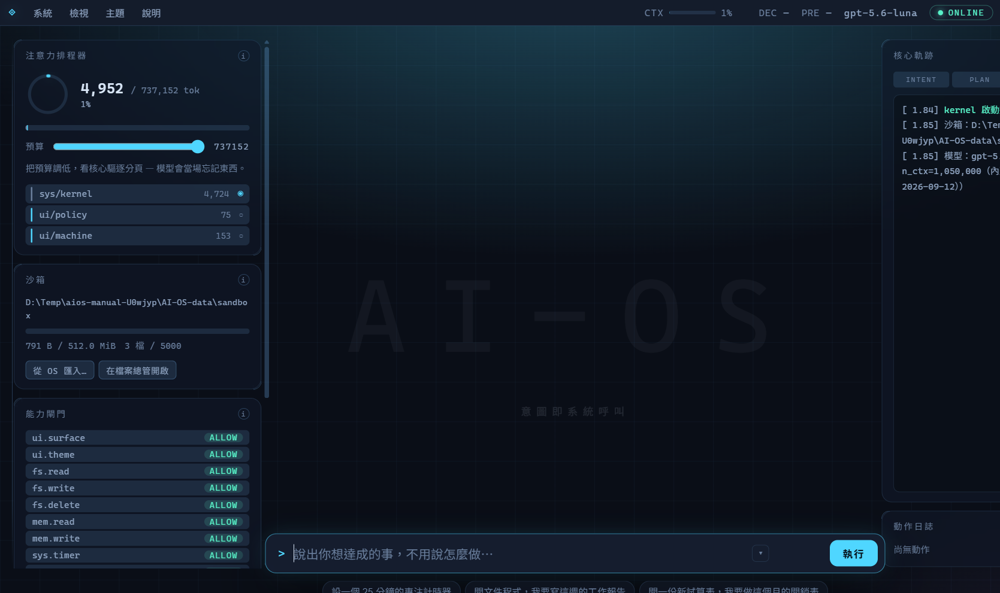
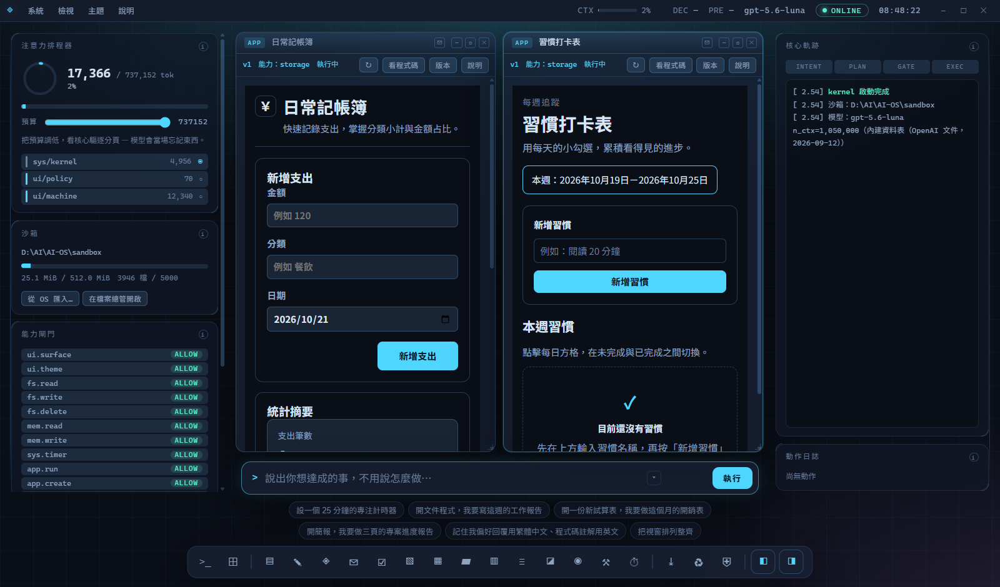

# AI-OS

一台跑在 Electron 裡的擬真 AI 作業系統。你用自然語言下指令，核心模型把它翻成一串
系統呼叫，核心逐一驗證、必要時問你，然後真的去做。

不是示範用的假介面：檔案是磁碟上真的檔案、瀏覽器是真的 Chromium、郵件走真的
IMAP/SMTP、產出的 `.docx`／`.xlsx`／`.pptx` 用 Word、Excel、PowerPoint 打得開，
而且系統可以在執行期間自己寫出新的程式並安裝起來。



> 與其他名為 AIOS 的專案（例如 agiresearch/AIOS）無關。

## 它做得到什麼

- **說要做什麼，不用說怎麼做。** 一句話會先被補成完整的任務說明，再由核心規劃成
  系統呼叫，每一步都攤在核心軌跡上。
- **真的檔案系統，關在沙箱裡。** 所有路徑都經過含納檢查，出不去；刪除會進沙箱的
  回收桶，所以動作日誌的「復原」是真的能還原。
- **內建應用程式。** 檔案總管、編輯器、瀏覽器（含網頁翻譯）、郵件與郵件待辦、文件、
  試算表、簡報、PDF 檢視器、Markdown、圖片、長期記憶、排程，以及讓系統自己寫程式的
  App Forge。每個視窗都有自己的 AI 對話。
- **缺什麼程式，就叫它自己寫，做好還能分享。** 在 App Forge 說一句需求，它會規劃、
  寫程式、檢查並實際跑一遍、審查，然後裝好打開；你沒說到的細節（資料要不要記住、
  沒資料時顯示什麼）會補上並列出來。做好的程式打包成一個 `.aiosapp` 檔就能給別人：
  不帶你的資料，也不帶執行許可；對方匯入前會重新檢查，並由系統自己的確認視窗列出
  它要的能力。
- **能力閘門與汙染降級。** 每個能力都是允許／詢問／拒絕。讀過網頁、郵件這類不可信的
  內容之後，會改動檔案、送資料出去、寄信或安裝新程式的能力都會降成「先問你」，
  新增排程與記住新的事也一樣；問你的視窗由主程序畫，被攻陷的畫面沒辦法自己核准自己。
- **核心模型可以換。** 地端的 llama.cpp `llama-server`，或 OpenAI、Gemini、DeepSeek、
  任何相容 OpenAI chat-completions 的服務。API 金鑰只待在主程序裡，用作業系統的
  金鑰保管加密存放。



## 需要什麼

- Windows 10／11 x64（目前只在 Windows 上開發與測試）
- 從原始碼執行：Node.js 24（開發與 CI 用的版本）
- 一個核心模型：雲端供應商的 API 金鑰，或自己準備的 llama.cpp `llama-server` 加一個
  GGUF 模型

## 快速開始

```powershell
git clone https://github.com/Cary5031/AI-OS.git
cd AI-OS
npm install
npm start
```

第一次開機還沒有任何核心模型，選單列右邊會顯示 OFFLINE。到 **系統 → 核心模型**
選一個供應商、貼上你自己的金鑰，就可以開始下指令。

### 用地端模型

AI-OS 不附 llama.cpp，也不附模型。兩種接法：

- 自己先把 `llama-server` 開起來，讓它在地端核心設定的端點（預設
  `http://127.0.0.1:8080`）上服務。AI-OS 開機時會直接接上去。
- 用環境變數 `AIOS_LLAMA_LAUNCHER` 指向啟動程式（`llama-server.exe` 本身，或一支
  `.ps1`），`AIOS_LLAMA_ARGS` 放它的參數。AI-OS 會在開機時啟動它、關機時收掉。

模型怎麼選、參數怎麼調，取決於你的顯卡。細節見
[docs/README.md 的〈地端核心〉](docs/README.md#地端核心)。

## 文件

| 文件 | 給誰看 |
| --- | --- |
| [manual/使用手冊.html](manual/使用手冊.html) | 使用者：照著畫面一步一步走 |
| [docs/README.md](docs/README.md) | 要改它的人：每個設計決定的原因、安全模型、每個程式的細節、測試、排除問題 |
| [docs/HANDOVER.md](docs/HANDOVER.md) | 開發交接記錄：每個問題怎麼重現、怎麼修、怎麼確認 |
| [docs/TODO.md](docs/TODO.md) | 想過、決定過，但還沒動手的事 |
| [CONTRIBUTING.md](CONTRIBUTING.md) | 想送修改進來的人 |
| [SECURITY.md](SECURITY.md) | 發現安全問題的人 |

## 測試與打包

```powershell
npm test               # 單元測試：讀原始碼，檢查接線與不變式
npm run test:e2e       # 端對端：真的啟動程式，用 CDP 驅動（會開視窗）
Build-AIOS.bat         # 測試全過才打包，免安裝版與安裝檔放在 dist\
```

打包出來的執行檔沒有程式碼簽章，第一次執行時 Windows SmartScreen 會擋一次。

## 使用前要知道的事

- **核心模型看得到你交給它的內容。** 選了雲端供應商，指令和它讀到的檔案、郵件、網頁
  內容會送到那家供應商；只想留在本機就用地端核心。
- **內建模型預設檔裡的金鑰等於公開。** 打包時可以把供應商設定連同金鑰封進安裝檔
  （`Build-AIOS.bat -WithPreset`），但解密所需的一切都在程式裡，原始碼又是公開的，
  拿到安裝檔的人都還原得出來。只放你願意被還原的金鑰，見
  [docs/README.md](docs/README.md#讓使用者裝好就能用內建模型預設檔)。
- **Outlook 網頁版的連接不是官方 API。** 郵件程式可以讀一個在瀏覽器分頁裡登入的
  Outlook 網頁信箱（唯讀），走的是 Outlook 網頁版自己使用的內部介面，不是 Microsoft
  公開的 API：隨時可能失效，也可能不符合你所在組織的 IT 政策，使用前請先確認。

## 授權

[MIT](LICENSE)
